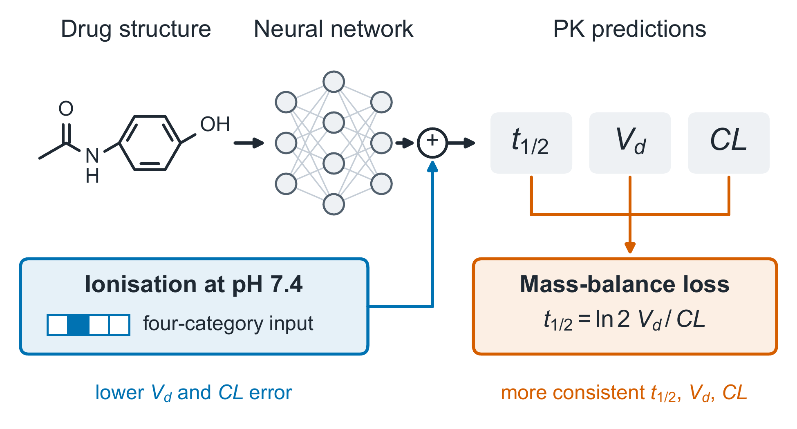

# Evaluating Ionisation Inputs and Mass-Balance Consistency in Neural Networks for Pharmacokinetic Prediction

Research code and reproducibility materials for studying how **explicit ionisation information** and a **soft output-consistency loss** affect pharmacokinetic prediction from molecular structure.



[Vector graphical abstract](assets/graphical-abstract.pdf) · [Reproduction guide](docs/reproduction.md)

## The scientific question

A molecular descriptor supplies information to a model; a consistency penalty changes how its outputs relate to one another. We evaluate these additions separately and together across **GraphConv**, **Chemprop** and **frozen ChemBERTa representations with a trainable prediction head**.

The ionisation input summarizes acidic and basic pKa information as a four-category one-hot vector at a specified pH. The soft loss penalizes disagreement among predicted half-life, volume of distribution and clearance in log10 space, using $t_{1/2}$ in h, $V_d$ in L and $CL$ in L h$^{-1}$:

$$
r = \log_{10} t_{1/2} - \log_{10} V_d + \log_{10} CL - \log_{10}(\ln 2).
$$

Training combines the supervised endpoint loss with a weighted mean of $r^2$. This encourages agreement with $t_{1/2}=\ln 2\,V_d/CL$ while retaining three directly predicted endpoints. Compiled clinical labels include different volume definitions and apparent oral parameters, so this relationship is an approximate consistency criterion for these data.

The analyses measure **endpoint accuracy and internal agreement separately**. Lower residuals alone do not establish better prediction or more accurate physiology. Algebraic post-processing baselines also derive each triad endpoint in turn from the other two predictions and measure the resulting accuracy change.

## Study design

Seven endpoints are predicted jointly: half-life, volume of distribution, clearance, peak concentration, time to peak, oral bioavailability and plasma protein binding. Missing observations are masked in the supervised loss.

| Cohort | Structures | Chemical groups | Role |
| --- | ---: | ---: | --- |
| Full pharmacokinetic cohort | 952 | 552 | Mass-balance loss and supplementary model comparisons |
| Paired numerical-pKa subset | 327 | 238 | Ionisation inputs, pH comparisons and combined experiments |
| Assigned ionisation-class cohort | 494 | 321 | Category-encoding comparison, including qualitative or bound-based assignments |

The full cohort contains 674 complete observed triads; the numerical-pKa subset contains 242. Endpoint accuracy uses the available labels for each endpoint, while predicted consistency can also be evaluated for incompletely labelled structures.

- **Nested grouped validation:** five outer folds and five inner folds, with frozen group assignments.
- **Training variability:** nine final seeds for the main comparisons; three seeds for the supplementary encoder, depth, task-weight and single-task comparisons.
- **Training-only transforms:** endpoint scaling and numerical-descriptor scaling are fitted within the relevant training partition.
- **Paired uncertainty:** whole-group bootstrap resampling, with fitted seeds fixed and the declared mean comparator MAE recomputed in each draw. Seed SDs describe training variability separately.

The fixed-capacity comparisons reuse selected structure-only settings across input/loss conditions. Their structure-only and pH 7.4 reference fits are shared between the ionisation and combined analyses. The robustness analysis also compares raw paired pKa values and Henderson–Hasselbalch fractions, with equal-budget input-specific configuration searches and input-specific penalty selection. Fixed-capacity and input-tuned results use separate, explicitly identified references.

Categories and continuous descriptors improve volume and clearance prediction across the three model families. Encoding effects depend on the model and endpoint: fractional inputs improve ChemBERTa beyond categories in some comparisons. The penalty improves internal agreement, with accuracy effects that depend on the input and model. Complete endpoint, interaction and observed-triad-stratum results are supplied with the analysis.

## Reproduce saved results or fit new models

There are two different workflows:

| Workflow | Purpose | Compute |
| --- | --- | --- |
| Reproduce saved results | Validate artifacts, rescore predictions, recompute intervals and redraw figures | CPU; Python or Docker as specified below |
| Refit models | Run the documented grouped training and selection procedures into a new output directory | A compatible training environment; GPU recommended |

Training-partition scales, validation-label counts and matched F/T calibration records are supplied in [Supplementary Data 3 and 4](reproducibility/supporting_data/README.txt), with a local rebuilding command in the reproduction guide.

Use the [reproduction guide](docs/reproduction.md) for environment setup, artifact preparation and the available entry points. Recomputed saved-prediction statistics and a fresh training run answer different reproducibility questions: refitting can vary with the hardware and numerical environment.

Clone the repository, then run the lightweight validation and point-metric checks with Python 3.11 or later. These checks use only the Python standard library:

```bash
git clone https://github.com/ThaoPham96/Evaluating-Ionisation-Inputs-and-Mass-Balance-Consistency-in-Neural-Networks-for-PK-Prediction.git pk-reproduction
cd pk-reproduction
python scripts/pipeline.py validate
python scripts/pipeline.py rescore
```

Rescored metrics and the validation report are written to `outputs/rescore/`. To rebuild figures or refit models, install Docker and build the reproduction image:

```bash
python scripts/build_runtime.py
python scripts/pipeline.py validate-robustness
python scripts/pipeline.py statistics --output outputs/statistics
python scripts/pipeline.py figures --output outputs/figures
```

The statistics command runs the complete 10,000-draw analysis, including the continuous-descriptor and tuning comparisons. The figure command rebuilds Figures 1, 2, 3, S1, S2 and S3 from the supplied scientific tables. These commands run in the local `pipknet-reproduction:20261114-v1` Docker image and perform no model fitting. The reproduction guide also documents the separately labelled historical analyses.

Model refitting is a separate step. For example, the following requests a new GraphConv outer-fold unit:

```bash
python scripts/pipeline.py train --campaign robustness --unit GraphConv-outer1-P0 --device cuda --output outputs/training
```

The training command performs model fitting. Use a new output directory and consult the [reproduction guide](docs/reproduction.md) for campaign selection, unit scope and hardware requirements. Fresh refits record the actual environment and receive new identities; archived predictions and fit identities remain available for exact saved-result checks.

## Data and provenance

The pharmacokinetic observations originate from [e-Drug3D](https://chemoinfo.ipmc.cnrs.fr/MOLDB/index.html). The study materials preserve reviewed model-input structures, source-row mappings, endpoint masks, chemical groups and nested split assignments. Grouping normalization is distinct from the molecular structures supplied to the models; model-input charge states are retained.

Numerical ionisation inputs use archived acidic/basic ChemAxon descriptors from ChEMBL. Their original extraction release, calculator build and settings were not recorded. The larger class cohort also uses documented qualitative, missing-channel and permanent-charge evidence. These categories are descriptor summaries, rather than complete multisite protonation distributions.

The required data and prediction tables are tracked as losslessly compressed files and verified when first materialized; saved-result checks need no external data download. Compact fit records support the full statistical replay, and selection records and provenance hashes are retained. Checkpoint weights are omitted. Follow the [reproduction guide](docs/reproduction.md) and retain the accompanying checksums and source notices. Code, source databases and third-party descriptors can have different redistribution terms.

## Manuscript and result status

This repository accompanies the working manuscript **“Evaluating Ionisation Inputs and Mass-Balance Consistency in Neural Networks for Pharmacokinetic Prediction.”** The graphical abstract above is the current manuscript graphic and summarizes the categorical-input and soft-loss comparison.

The repository includes the original comparisons, revised uncertainty analysis, algebraic-derivation controls, and completed continuous-descriptor and input-specific tuning experiments. The [release status](reproducibility/RELEASE_STATUS.json) identifies the included results and validation scope. The manuscript is a working paper; cite the repository version or commit used alongside its title and authors.

## Citation

For the current research materials, cite the authors, manuscript title and repository version or commit used:

> Pham T, Ghafoor M, Delgado-San Martin J, Chiong J, Khoo S, Wang D, Siccardi M. *Evaluating Ionisation Inputs and Mass-Balance Consistency in Neural Networks for Pharmacokinetic Prediction.* Working manuscript and research software, 2026.

[Repository](https://github.com/ThaoPham96/Evaluating-Ionisation-Inputs-and-Mass-Balance-Consistency-in-Neural-Networks-for-PK-Prediction) · [Report an issue](https://github.com/ThaoPham96/Evaluating-Ionisation-Inputs-and-Mass-Balance-Consistency-in-Neural-Networks-for-PK-Prediction/issues)
